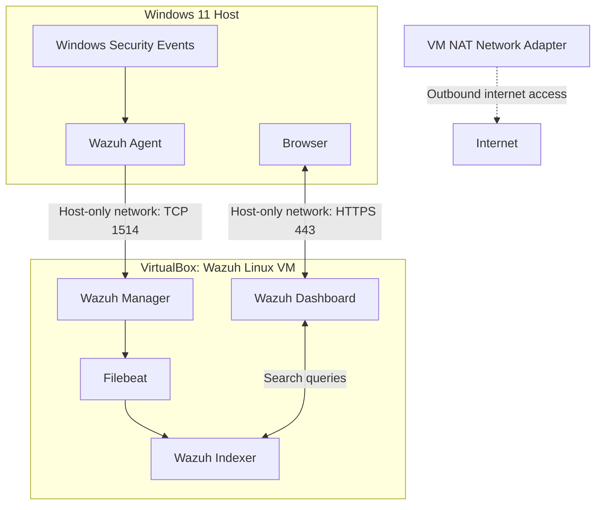
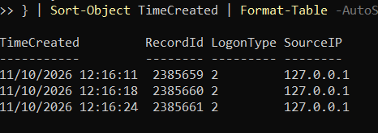

# SOC Monitoring and Threat Detection Lab

## Project Overview
This project demonstrates the setup and use of a Security Information and Event Management (SIEM) environment using Wazuh to monitor Windows security events, detect suspicious authentication activity and investigate security alerts.

I deployed Wazuh in a Linux virtual machine, connected a Windows 11 endpoint using the Wazuh agent, and developed a custom correlation rule to detect three failed login attempts against the same account within 120 seconds.

I then simulated failed logins, verified the resulting alerts against Windows Security logs, and documented the investigation findings, including the classification of the activity and recommended response.

## Objectives
- Deploy a Wazuh SIEM environment using VirtualBox and configure a Windows 11 endpoint for security event monitoring.
- Develop and test a custom correlation rule to identify repeated failed Windows logins within a defined timeframe.
- Investigate generated alerts using Wazuh and Windows Security logs, document findings, and determine an appropriate response.

## Lab Architecture
The SOC lab was built on a Windows 11 Home laptop using Oracle VirtualBox. The Wazuh server runs inside a Linux virtual machine, while the Wazuh agent is installed directly on the Windows host.

| Component | Configuration |
|---|---|
| Host OS | Windows 11 Home, 16 GB RAM |
| Virtualisation | Oracle VirtualBox |
| Wazuh Server | Linux VM, ~6 GB RAM, 4 vCPUs |
| Monitoring | Wazuh Agent 4.14.8 on Windows |
| Host-only Network | Windows: 192.168.26.1; Wazuh: 192.168.26.100 |
| NAT Network | Outbound connectivity for Wazuh VM |

### Security Event Flow
1. Windows records authentication events.
2. The Wazuh agent collects configured security events and forwards them to the Wazuh Manager.
3. The Manager applies detection rules and generates alerts.
4. Filebeat forwards alert data to the Wazuh Indexer.
5. The Dashboard allows analysts to search and investigate alerts.

## Tools and Technologies
| Tool / Technology | Purpose |
|---|---|
| Oracle VirtualBox | Hosted the Wazuh Linux VM and configured virtual networking. |
| Wazuh 4.14.8 | Analysed security events and generated searchable alerts. |
| Wazuh Windows Agent | Collected Windows security logs and forwarded them to the manager. |
| Windows Event Viewer | Investigated authentication events 4624 and 4625. |
| PowerShell | Managed Windows services and queried security events. |
| Linux command line | Checked system health, managed Wazuh services and validated rules. |
| XML | Created the custom correlation detection rule. |
| Git and Markdown | Organised local project files and documented the investigation. |

## Implementation

### 1. Wazuh Server Setup

Imported the Wazuh 4.14.8 virtual appliance into Oracle VirtualBox on a Windows 11 Home laptop.

Configured the VM with approximately 6 GB RAM, four virtual CPUs and a 25 GB virtual disk.

Configured two virtual network adapters:

- **NAT Network:** Provided outbound network connectivity.
- **Host-only Adapter:** Enabled communication between the Windows host (`192.168.26.1`) and the Wazuh server (`192.168.26.100`).

Verified the VM's IP addresses using `ip -br -4 addr`, checked disk availability using `df -h`, and confirmed that the Wazuh Manager, Indexer and Dashboard services were running.

### 2. Windows Agent Deployment

Installed Wazuh Agent 4.14.8 directly on the Windows 11 host and configured it to communicate with the Wazuh Manager at `192.168.26.100`.

Registered the endpoint as `win11-lab-host` and verified its Active status in the Wazuh Dashboard.

Confirmed network connectivity using TCP port 1515 for initial enrolment and TCP port 1514 for regular agent communication.

Verified that the agent was configured to collect Windows Security events through the `eventchannel` log format.

Finally, confirmed that Windows Event IDs `4624` and `4625` produced searchable alerts in Wazuh.

## Detection Rule
Created a custom Wazuh correlation rule in `/var/ossec/etc/rules/local_rules.xml` to identify repeated Windows authentication failures.

**Detection rule source:**
[View custom detection rule](detection_rules/repeated_failed_logins.xml)

### Rule Configuration

| Setting | Value |
|---|---|
| Custom Rule ID | `100120` |
| Parent Rule ID | `60122` |
| Severity | Level 10 |
| Frequency | 3 failed logins |
| Timeframe | 120 seconds |
| Correlation field | `win.eventdata.targetUserName` |

The rule uses <if_matched_sid> to correlate events matching Wazuh's existing authentication-failure rule 60122. The <same_field> condition requires the failures to target the same username.

This extends individual failed-login detection into a time-based correlation designed to identify potentially suspicious repeated authentication attempts.

## Testing and Investigation
Validated the custom detection configuration using `sudo /var/ossec/bin/wazuh-analysisd -t`, which returned exit code 0.

After restarting the Wazuh Manager, I performed a controlled authentication test against a dedicated standard Windows account named SOC-Lab-Test.

Three incorrect passwords were entered within approximately 13 seconds.

Windows Security logs recorded three Event ID 4625 failures at:

12:16:11

12:16:18

12:16:24

The custom rule successfully generated a level 10 Wazuh alert (Rule ID `100120`) at 12:16:45.738 on 11 October 2026.

The detection was verified by comparing Windows Security logs with the Wazuh alert details.

The resulting investigation classified the detection as a true positive for the repeated-failure pattern, while the underlying activity was confirmed as benign, authorised testing.

Note: The historical alert description stated 180 seconds, although the tested rule was configured with a 120-second window. The description was subsequently corrected and the configuration revalidated.

**Full investigation:**
[Read the SOC investigation report](investigation/failed-login-investigation.md)

## Results and Limitations
### Results
The SOC lab successfully collected Windows Security events and generated alerts through Wazuh.

Key results:

- Connected a Windows 11 endpoint to the Wazuh Manager and verified its Active status.
- Confirmed collection and detection of Windows Event IDs 4624 and 4625.
- Developed and validated custom correlation rule 100120.
- Generated three controlled failed logins within 13 seconds, successfully triggering a level 10 alert.
- Correlated Wazuh alerts with the original Windows Security records.
- Completed an investigation report classifying the detection as a true positive for benign, authorised testing.

### Limitations
- The lab contains one monitored Windows endpoint.
- Only the positive detection scenario was tested; negative and boundary conditions require further testing.
- Three failed logins within 120 seconds can result from legitimate user mistakes.
- The rule does not independently determine whether authentication failures are malicious.
- The detection has not been evaluated for performance, reliability or alert volume in a production environment.

## Lessons Learned
This project developed my understanding of how security telemetry travels from a monitored endpoint through a SIEM detection and investigation pipeline.

I learned how to configure Windows event collection, investigate authentication events, build a Wazuh correlation rule and verify its behaviour against actual security logs.

An important lesson was that a successfully triggered alert is not necessarily evidence of an attack. SOC analysts must examine supporting evidence, understand detection limitations and make proportionate response decisions.

## Evidence

### Custom Wazuh Detection Alert

### Windows Failed Login Events

### Additional Verification

- [Windows agent active](evidence/03_windows-agent-active.png)
- [Custom rule validation](evidence/04_rule-validation.png)